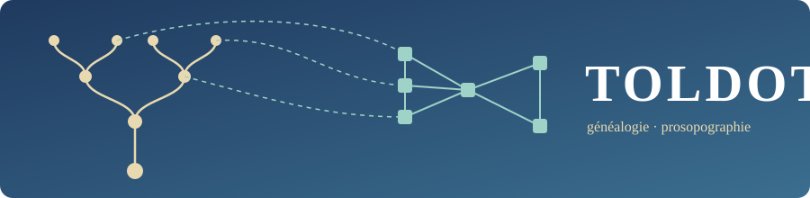

<div align="center">



# TOLDOT

**De la généalogie GeneWeb à la prosopographie : parser fiable, modèle objet, organisations, graphes et enrichissement par LLM.**

[English version → README.en.md](README.en.md)

[](https://github.com/Relais4x100a2/toldot/actions/workflows/ci.yml)


[](LICENSE)

</div>

---

## En deux minutes

[GeneWeb](https://geneweb.tuxfamily.org/) est un logiciel de généalogie très répandu, dont le format texte natif (`.gw`) sert de pivot à de nombreuses bases savantes. Ce format décrit des **familles** et des **personnes**, mais pas ce que les chercheurs veulent souvent étudier : **les institutions, écoles, métiers, associations** auxquelles ces personnes ont appartenu. Ces informations existent bel et bien dans les bases, mais cachées dans des événements personnalisés saisis librement (`#Membre_1900`, `#Cours_peinture`, `#Action-Sociale`…).

TOLDOT s'attaque à ce problème en trois temps :

1. **Lire** un fichier `.gw` sans rien perdre, avec un parser testé sur des cas limites (apostrophes, calendriers multiples, dates approximatives, extensions GW Plus, encodages).
2. **Modéliser** : en plus de `Person`, `Family` et `Event`, une entité **`Organization`** reliée aux personnes par des liens datés. Le fichier `.gw` n'est jamais modifié ; les organisations vivent dans un fichier compagnon JSON.
3. **Découvrir** les organisations cachées dans les événements libres, d'abord par des **règles déterministes** auditables, puis avec l'aide d'un **LLM** que l'on peut optimiser (DSPy) et valider humainement.


<p align="center"><br><em>Illustrations originales du dépôt, dédiées au domaine public (CC0).</em></p>

```
                ┌───────────────────────────────────────────────────────┐
  base.gw  ───► │  core / geneweb-py                                    │
                │  lexer → syntaxe → modèles → validation               │
                │      │                                                │
                │      ├─► formats/   GEDCOM · JSON · XML · sidecar org │
                │      ├─► api/       REST FastAPI (sessions éphémères) │
                │      ├─► cli/       geneweb-py parse | export         │
                │      └─► analytics/ graphes (NetworkX, GraphML, GEXF) │
                └────────────────────────────┬──────────────────────────┘
                                             │ import
                ┌────────────────────────────▼──────────────────────────┐
                │  app / geneweb-app  (Streamlit + DSPy + OpenRouter)   │
                │  extraction → annotation → prompt → optimisation      │
                │  → validation → transformation de masse → dashboard   │
                └───────────────────────────────────────────────────────┘
```

## Le problème de recherche et l'approche

Un événement personnel dans un `.gw` ressemble à ceci (fixture synthétique) :

```
pevt DUPONT Jean
#birt 1870 #p Lyon                       ← événement standard, déjà exploitable
#occu 1895 #p [Atelier_Rose]_-_Lyon      ← lieu avec complément : « Atelier Rose » à Lyon
#Cours_peinture ~1890                    ← texte libre : une école ? un atelier ?
#Membre_1900 1900                        ← appartenance à quelque chose
#Action-Sociale 1905 #s Archives         ← une association ?
end pevt
```

Les événements standards (`#birt`, `#deat`…) sont déjà bien structurés. Les autres sont du **texte libre** : on ne peut pas les interroger, les compter ni les relier entre personnes. L'approche de TOLDOT est volontairement **à étages**, du moins coûteux au plus incertain :

| Étage | Mécanisme | Pourquoi |
|---|---|---|
| 1. Règles | `EventToOrganizationMapper` : préfixes de rôle (`Membre`, `Élève`, `Employé`, `Soldat`…) et lieux « `[Complément]_-_Ville` » → proposition d'organisation avec un **score de confiance** | Déterministe, rapide, gratuit, explicable, reproductible |
| 2. LLM (optionnel) | Un hook branchable arbitre les cas sans signal. Les prompts sont **annotés puis optimisés avec DSPy** à partir d'exemples étiquetés à la main | N'intervient que là où les règles échouent ; ne remplace pas la décision humaine |
| 3. Humain | Pages de validation de l'application avant toute transformation de masse | Une base prosopographique ne tolère pas les inventions silencieuses |

Le résultat est stocké dans un **fichier compagnon `base.org.json`** (organisations + liens personne↔organisation, avec périodes), ce qui garde la source `.gw` intacte et le travail **réversible**.

## Structure du dépôt

```
toldot/
├── core/                      Paquet `geneweb-py` : le moteur (bibliothèque + API + CLI)
│   ├── src/geneweb_py/
│   │   ├── parser/            lexical → syntax → gw_parser (+ multipass, streaming)
│   │   ├── core/              Date, Person, Family, Event, Place, Organization, Genealogy, validation
│   │   ├── formats/           GEDCOM, JSON, XML, fichier compagnon d'organisations
│   │   ├── api/               FastAPI : sessions, persons, families, events, genealogy
│   │   ├── cli/               binaire `geneweb-py` (Click + Rich)
│   │   └── analytics/         réseaux (extra facultatif)
│   ├── tests/                 1245 tests ; fixtures `.gw` strictement synthétiques
│   └── doc/                   architecture, performances, feuille de route
├── app/                       Application d'enrichissement (Streamlit / DSPy / OpenRouter)
│   ├── docker/geneweb-app/    paquet `geneweb-app` : pages Streamlit + `src/`
│   ├── docker/geneweb-server/ serveur GeneWeb OCaml (implémentation de référence, en conteneur)
│   └── docker-compose.yml
├── run_app.sh                 lance l'application en une commande
├── pyproject.toml · uv.lock   workspace uv (membres : core, app/docker/geneweb-app)
└── .github/workflows/ci.yml   lint, types, tests 3.11 → 3.13, build Docker
```

### Module `core` : le moteur

Le flux de données, de bout en bout :

```
.gw → lexical.py (tokens) → syntax.py (nœuds) → gw_parser.py [+ MultiPassParser] → Genealogy
    → formats/ (GEDCOM · JSON · XML)   ou   api/ (REST, par session)   ou   cli/
```

- **Parser** : tokenisation à cache LRU, puis analyse syntaxique, puis construction des modèles. Un mode **streaming** s'active au-delà de 10 Mo (environ 80 % de mémoire en moins) ; un mode **multi-passes** résout les références croisées (familles, témoins) sur les bases complexes. Ils se combinent.
- **Modèles** : dataclasses pour `Date` (multi-calendriers, préfixes `~ ? < >`, intervalles), `Person`, `Family`, `Event`, `Place`, `Organization`, regroupées dans `Genealogy`.
- **Validation** : mode *strict* (s'arrête à la première erreur) ou *gracieux* (collecte toutes les erreurs avec ligne, token et suggestion).
- **Formats** : export GEDCOM, JSON, XML, et fichier compagnon `.org.json`.
- **API REST** : FastAPI. Elle repose sur des **sessions éphémères en mémoire** (voir [Choix techniques](#choix-techniques-notables)).
- **CLI** : `geneweb-py parse` et `geneweb-py export`.
- **Analytics** : construit un réseau personnes↔organisations et l'exporte vers NetworkX, GraphML, GEXF (Gephi), vis.js ou Pyvis (HTML).

Détails : [`core/README.md`](core/README.md), [`core/AGENTS.md`](core/AGENTS.md), [`core/doc/`](core/doc/).

### Module `app` : l'atelier d'enrichissement

Application Streamlit qui guide l'enrichissement en sept pages, de l'extraction au tableau de bord :

| Page | Rôle |
|---|---|
| 1. Upload & extraction | Charge un `.gw` et isole les événements personnalisés (`#strng`) |
| 2. Annotation | Étiquetage manuel d'un petit corpus d'exemples |
| 3. Enrichissement de prompt | Construit le prompt à partir des annotations |
| 4. Optimisation DSPy | Optimise automatiquement le prompt sur le corpus annoté |
| 5. Validation | Relecture humaine des transformations proposées |
| 6. Transformation de masse | Applique le traitement validé à toute la base |
| 7. Dashboard | Suivi et indicateurs |

L'application s'appuie sur `geneweb-py` via un adaptateur (`src/gw_adapter.py`) : il n'y a **qu'un seul parser** dans le monorepo. Les modèles LLM passent par [OpenRouter](https://openrouter.ai/) (Claude, GPT, Mistral, Gemini…).

Détails : [`app/README.md`](app/README.md), [`app/doc/`](app/doc/).

## Démarrage rapide

### Prérequis

- [`uv`](https://docs.astral.sh/uv/) (gestionnaire Python utilisé exclusivement ici) : `curl -LsSf https://astral.sh/uv/install.sh | sh`
- Python 3.11+ (uv le télécharge au besoin)
- Docker, seulement si vous voulez la pile conteneurisée
- Une clé OpenRouter, seulement pour les pages LLM de l'application

### 1. Installer

```bash
git clone https://github.com/Relais4x100a2/toldot.git
cd toldot
uv sync --all-packages --all-extras
```

### 2. Vérifier que tout fonctionne

```bash
uv run --package geneweb-py python -m pytest core
# attendu : 1245 passed, 17 skipped
```

### 3. Essayer le CLI sur une fixture

```bash
uv run --package geneweb-py geneweb-py parse core/tests/fixtures/sample_tree.gw
```

Vous obtenez un tableau de synthèse (encodage détecté, validité, 9 personnes, 3 familles, 4 liens enfants). Ensuite, exporter :

```bash
uv run --package geneweb-py geneweb-py export core/tests/fixtures/sample_tree.gw --format gedcom -o /tmp/sortie.ged
uv run --package geneweb-py geneweb-py export core/tests/fixtures/sample_tree.gw --format json   -o /tmp/sortie.json
```

### 4. Utiliser la bibliothèque en Python

```python
from geneweb_py import GeneWebParser

parser = GeneWebParser()

# Parser un fichier
genealogy = parser.parse_file("core/tests/fixtures/rich_pevt_wit.gw")
print(len(genealogy.persons), "personnes,", len(genealogy.families), "familles")

# Étage 1 : déduire des organisations depuis un événement libre (règles seules)
text = """encoding: utf-8
gwplus

pevt DUPONT Jean
#Cours_peinture 1890 #p [Atelier_Rose]_-_Lyon
end pevt
"""
g = parser.parse_string(text)
print(g.infer_organizations())            # (1, 1) : 1 organisation, 1 lien
print(g.get_organization("atelier_rose_lyon").name)   # Atelier Rose
```

Pour les très gros fichiers : `GeneWebParser(stream_mode=True, use_multipass=True)`.

### 5. Lancer l'API REST

```bash
cd core && uv run python run_api.py --reload
# documentation interactive : http://127.0.0.1:8000/docs
```

Les données sont servies **par session** : on envoie d'abord le fichier, puis on utilise le jeton renvoyé.

```bash
curl -F "file=@tests/fixtures/sample_tree.gw" http://127.0.0.1:8000/api/v1/sessions/
# → réponse : {"session_token": "...", "expires_at": "...", "stats": {"persons": 9, "families": 3}}
curl -H "X-Session-Token: <jeton>" http://127.0.0.1:8000/api/v1/persons/
```

### 6. Lancer l'application d'enrichissement

```bash
./run_app.sh                       # Streamlit sur http://localhost:8501
```

Dans le panneau latéral, saisissez votre clé OpenRouter (elle n'est jamais écrite dans le code ; pour Docker, voir `app/.env.example`).

Ou en conteneurs, avec le serveur GeneWeb de référence :

```bash
docker compose -f app/docker-compose.yml up -d --build
```

> Toute modification de `core/` impose de reconstruire l'image Docker.

### Analyse de réseaux

```bash
uv sync --extra analytics          # networkx + pyvis
```

Depuis une `Genealogy`, `build_network(genealogy)` produit un réseau exportable en GraphML ou GEXF (ouvrable dans Gephi), en JSON vis.js ou en HTML Pyvis, avec une projection `co_membership()` (personnes liées par une organisation commune).

## Choix techniques notables

- **Un seul parser, écrit à la main.** Pas de grammaire générée : le format `.gw` a trop de cas particuliers (apostrophes, occurrences `Dupont.1`, blocs `notes-db`, extensions GW Plus) pour qu'une grammaire reste lisible. Lark est présent comme extra expérimental mais n'est **pas** utilisé.
- **Le `.gw` n'est jamais réécrit.** Les organisations vivent dans un fichier compagnon : la source de l'historien reste intacte et le travail réversible.
- **Règles d'abord, LLM ensuite.** Le LLM est un recours, jamais le point de départ : ce qui peut être décidé de façon déterministe l'est, avec un score de confiance.
- **Vie privée par conception.** Les sessions de l'API sont en mémoire, expirent (TTL glissant d'une heure) et ne sont jamais persistées. Les en-têtes de sécurité, le CORS fermé par défaut en production, la limite de taille d'upload (50 Mo) et le *rate limiting* (5 créations de session par heure) complètent le dispositif. Le parser embarque des garde-fous contre les entrées démesurées.
- **Qualité outillée.** ruff, mypy sur l'ensemble de `core`, couverture ≥ 80 %, tests marqués (`unit`, `integration`, `slow`, `security`, `performance`…), CI sur Python 3.11, 3.12 et 3.13.
- **Un workspace `uv`, un seul `uv.lock`.** `core` et `app` se résolvent ensemble ; aucun chemin relatif entre eux.
- **Politique de données stricte.** Aucune donnée généalogique réelle dans ce dépôt : les fixtures sont synthétiques (`DUPONT Jean`, `MARTIN Marie`…).

## Contribuer et vérifier la qualité

```bash
uv run --package geneweb-py ruff check core/src core/tests --ignore E501
uv run --package geneweb-py ruff format --check core/src core/tests
uv run --package geneweb-py mypy core/src/geneweb_py
uv run --package geneweb-py python -m pytest core --cov=geneweb_py
uv lock --check
```

Conventions : messages de commit en anglais au format `type(scope): message` (`feat`, `fix`, `docs`, `test`, `chore`), un sujet par commit, tests verts à chaque étape. **N'ajoutez jamais de vraie donnée généalogique** (`*.gw`, `*.ged` réels, noms de vraies personnes) : voir [`AGENTS.md`](AGENTS.md).

## Feuille de route

- Rattachement des personnes et organisations à des référentiels d'autorité (VIAF, Wikidata).
- Export CSV individus / organisations / événements.

Voir [`core/doc/roadmap.md`](core/doc/roadmap.md).

## Licence

[MIT](LICENSE) © Guillaume Cayeux.

Le format `.gw` est celui du logiciel [GeneWeb](https://geneweb.tuxfamily.org/) ; TOLDOT est un projet indépendant, non affilié à GeneWeb.
