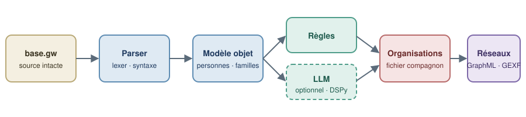

<p align="center"></p>

# GeneWeb Revamped - Processeur de Fichiers via LLM

Cette application Streamlit analyse les fichiers GeneWeb (`.gw`) et utilise l'intelligence artificielle via OpenRouter pour identifier et transformer les événements personnalisés en nouvelles entités organisationnelles.

## 🚀 Fonctionnalités

- **Analyse intelligente** : Utilise des LLM pour identifier les organisations dans les événements personnalisés
- **Interface web intuitive** : Interface Streamlit facile à utiliser
- **Support OpenRouter** : Compatible avec de nombreux modèles LLM (GPT, Claude, Mistral, etc.)
- **Transformation automatique** : Convertit les événements en blocs d'organisations structurés
- **Téléchargement direct** : Génère et télécharge les fichiers GeneWeb modifiés

## 📋 Prérequis

- Docker et Docker Compose
- Clé API OpenRouter (gratuite disponible sur [openrouter.ai](https://openrouter.ai/keys))

## 🛠️ Installation et Lancement

### Option 1 : Docker Compose (Recommandé)

```bash
# Cloner/télécharger le projet
git clone <votre-repo> # ou copier les fichiers
cd geneweb_revamped

# Construire et lancer l'application
docker-compose up --build

# L'application sera accessible sur http://localhost:8501
```

### Option 2 : Développement local avec uv

```bash
# Installer uv si ce n'est pas déjà fait
curl -LsSf https://astral.sh/uv/install.sh | sh

# Installer les dépendances
uv sync

# Lancer l'application
uv run streamlit run app.py
```

## 🔧 Configuration

1. **Clé API OpenRouter** : 
   - Créez un compte gratuit sur [OpenRouter](https://openrouter.ai)
   - Générez votre clé API dans les [paramètres](https://openrouter.ai/keys)
   - Entrez la clé dans le panneau latéral de l'application

2. **Choix du modèle** :
   - Modèle par défaut : `mistralai/mistral-7b-instruct:free` (gratuit)
   - Autres options populaires :
     - `google/gemini-flash-1.5` (rapide et efficace)
     - `anthropic/claude-3-haiku` (qualité élevée)
     - `openai/gpt-3.5-turbo` (référence)

3. **URL de référence** : Laissez `http://localhost:8501` pour un usage local

## 📝 Utilisation

1. **Lancez l'application** via Docker Compose ou directement
2. **Configurez l'API** dans le panneau latéral gauche
3. **Téléversez votre fichier** GeneWeb (.gw)
4. **Cliquez sur "Lancer l'analyse"** pour traiter le fichier
5. **Téléchargez le résultat** transformé

## 📁 Structure du Projet

```
geneweb_revamped/
├── 📁 docker/                    # Configuration Docker par service
│   ├── 📁 geneweb-app/           # Application Streamlit
│   └── 📁 geneweb-server/        # Serveur GeneWeb 7.0.0
├── 📁 data/                      # Données persistantes
│   ├── 📁 geneweb_bases/         # Bases généalogiques GeneWeb
│   └── 📁 streamlit_data/        # Données de l'application Streamlit
├── 📁 doc/                       # 📚 Documentation centralisée
│   ├── 📁 general/               # Documentation générale
│   ├── 📁 guides/                # Guides d'utilisation
│   ├── 📁 technical/             # Documentation technique
│   ├── 📁 tests/                 # Tests et validation
│   └── 📁 common/                # Configuration commune
├── 📄 docker-compose.yml         # Orchestration des services
└── 📄 README.md                  # Ce fichier
```

> 📚 **Documentation complète** : Consultez le dossier [`doc/`](./doc/) pour une documentation détaillée et organisée.

## 🔍 Comment ça marche

1. **Analyse** : L'application scanne les blocs `pevt` dans votre fichier GeneWeb
2. **Identification** : Les événements non-standard sont envoyés au LLM pour déterminer s'ils représentent des organisations
3. **Transformation** : Les événements identifiés comme organisations sont convertis en nouveaux blocs `pevt` avec le type `ORG_`
4. **Génération** : Un nouveau fichier GeneWeb est créé avec les transformations appliquées

## 🚨 Dépannage

### L'application ne se lance pas
```bash
# Vérifier les logs Docker
docker-compose logs geneweb-app

# Reconstruire en cas de problème
docker-compose down
docker-compose up --build
```

### Erreurs d'API OpenRouter
- Vérifiez que votre clé API est valide
- Assurez-vous d'avoir du crédit (ou utilisez un modèle gratuit)
- Vérifiez votre connexion internet

### Port déjà utilisé
```bash
# Changer le port dans docker-compose.yml
ports:
  - "8502:8501"  # Utilise le port 8502 à la place
```

> 📚 **Dépannage détaillé** : Consultez la [documentation complète](./doc/) pour plus d'informations sur la résolution des problèmes.

## 🤝 Contribution

Les contributions sont les bienvenues ! N'hésitez pas à :
- Signaler des bugs
- Proposer des améliorations
- Ajouter des fonctionnalités

## 📄 Licence

Ce projet est sous licence MIT. Voir le fichier LICENSE pour plus de détails.
